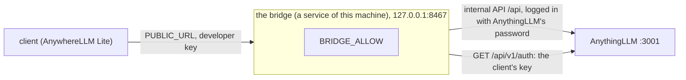

# anywherellm-bridge

A bridge to the parts of AnythingLLM that only its own settings pages reach: its **internal API** (`/api`), which the developer API (`/api/v1`) leaves out. A client such as AnywhereLLM Lite calls the bridge with only a developer key; the bridge logs in to the internal API with AnythingLLM's password and passes on the routes you list.

It needs nothing from AnythingLLM beyond a stock instance and adds no skill. It reads one file of the suite's, the links to its Library and Vault pages (below), and writes none but, if you ask for it, the control server (below), which is not part of the bridge's service. What each route does is AnythingLLM's own, so the caller knows the routes; [docs/endpoints.md](docs/endpoints.md) records the ones worth opening, with their shapes as AnythingLLM 1.16.2 gives them.

It is one file, `dist/anywherellm-bridge.cjs`, that runs on Node 20.3 or later and needs nothing installed beside it. Only the phone app needs it. It moved here from [anywherellm-suite](https://github.com/BinaryBand/anywherellm-suite) (the control server and agent skills), whose installer no longer sets it up.



## The bridge

It listens on `BRIDGE_PORT` (8467), on 127.0.0.1.

- `GET /health` needs no key: `{"ok": true, "service": "anywherellm-bridge", "allow": [...], "pages": true}`. `pages` is false when the bridge doesn't know AnythingLLM's storage.
- Any other request needs `Authorization: Bearer <developer key>`, which AnythingLLM must accept. Any origin may call it, and a preflight needs no key.
- `<METHOD> /<path>` (GET, POST, PUT or DELETE) is AnythingLLM's `/api/<path>`, with the query string and the JSON body sent on. AnythingLLM's status and JSON come back as they are: a 400 with `{"job": null, "error": ...}` stays that.
- A route is passed only when `BRIDGE_ALLOW` lists it. Any other is `403`. With the setting empty, nothing passes.
- The bridge's own failures are `{"error": "..."}`: 400 a bad request (a path with `.`, `..` or an empty segment, a body that isn't JSON), 401 no accepted key, 403 a route not allowed, 405 another method, 413 a body over 8 MiB, 502 AnythingLLM can't be reached or refused the bridge's login.
- A client that disconnects before the answer ends the call to AnythingLLM too (Node 20.3 or later for `AbortSignal.any`); a POST may already have taken effect there.
- Replies are JSON. A route that sends a file or a stream isn't for the bridge.

**The suite's pages.** `GET /pages` answers `{"library": "/library-lean/<token>.html", "vault": "/vault-lean/<token>.html"}`: the root-relative paths of the suite's Library and Vault pages, which AnywhereLLM Lite opens on AnythingLLM's address. The suite's skills keep them in `<storage>/anywherellm-suite/page-links.json` (the suite's `docs/page-links.md` is the contract), and the bridge reads that file afresh at each call, so a page whose token was replaced shows its new path at once. The route is the bridge's own, not AnythingLLM's, and is there only when `ANYTHINGLLM_STORAGE` is set; without it `/pages` is a path like any other, refused unless `BRIDGE_ALLOW` lists it.

- It takes only the developer key named `AnywhereLLM`, the one `pair` hands out, which the bridge looks up in AnythingLLM's key list (cached as the key check is): a key not in the list gets 401, and any other key in it 403, so a key the agent holds can't learn where the pages are. Any method but GET is a 405.
- A page is `null` when it hasn't been shown yet, and also when its path isn't exactly `/library-lean/` or `/vault-lean/` with 24 base64url characters and `.html`, or the file is missing, a link, not a plain file, over 64 KiB or not JSON. Code in AnythingLLM's container can write the file, so nothing else in it is answered, and a bad value is never shown or logged.
- A path is a bearer capability: whoever opens the page can post to it. The bridge never logs one; its request log names the route, `/pages`.

**Why a list.** The bridge holds AnythingLLM's password, so anyone with a developer key could do what the settings pages do, down to reading the key list or rewriting `.env` through `system/update-env`, unless the bridge says no. List what a client needs and no more.

`BRIDGE_ALLOW` is comma-separated entries of `[METHOD ]/path/prefix`. A prefix matches whole path segments, a `*` segment matches any one segment, and an entry with no method allows all four:

```sh
BRIDGE_ALLOW=GET /scheduled-jobs, GET /setup-complete, /workspaces, POST /system/custom-models
```

`/workspaces` passes `/workspaces/home/memories` but not `/workspaces-old`. `POST /workspace/*/thread/*/update` passes `/workspace/home/thread/abc/update` for any workspace and thread, and not `/workspace/home/update`: a route with the workspace in its middle can be allowed without allowing the whole `/workspace` tree, which also deletes a workspace and resets its vectors.

`install` sets `BRIDGE_ALLOW` to the list in [default-allow.txt](default-allow.txt) (one entry per line there, joined with commas into the setting; `tools/routes` checks that AnythingLLM still has each route), unless the settings file sets it already, empty included. A list of your own stays. The bridge logs in as AnythingLLM's pages do: `POST /api/request-token` with the password, which is `AUTH_TOKEN` in AnythingLLM's `.env`. It keeps the token, logs in again after a 401, reads the password afresh at each login, and sends none when none is set. Multi-user mode isn't supported.

## The control server

The agent's own tools for AnythingLLM's chats (`chat_workspaces`, `chat_list`, `chat_history`, `chat_new`, `chat_rename`, `chat_clear`, `chat_delete`) and, with the `schedule` role, its scheduled jobs (one tool, `schedule`: list, add, update, delete). It is a second file, `dist/control.cjs`, built into the bridge, which `install --control` writes into the storage (`<storage>/anywherellm-bridge/control.cjs`) with an entry `control` in `plugins/anythingllm_mcp_servers.json`. AnythingLLM starts it itself as an MCP server over stdio, with its own `node` (the image's, Node 18) and its own environment, so it logs in to the internal API with `AUTH_TOKEN` as it finds it there: no service, socket or key, and the bridge doesn't need to be running. It moved here from the suite (see [docs/notes.md](docs/notes.md)).

```sh
node anywherellm-bridge.cjs install --storage DIR --control --no-start    # the control server only, no phone
node anywherellm-bridge.cjs install --storage DIR --control --roles chat,schedule
```

- `--roles` is `chat` (default, and what a reinstall keeps) and/or `schedule`. Only `chat` is on by default: a scheduled job runs a prompt as the agent, unattended, so adding one plants an instruction that runs later.
- `--runtime container|native`: the entry runs the container's own `node` on the path the container sees (`/app/server/storage`), or the `node` that ran install, on the host's path. A reinstall keeps the runtime of the entry it finds; otherwise native for AnythingLLM Desktop's storage and container for any other.
- Then, in AnythingLLM, Settings > Agent Skills: refresh the MCP servers (or restart AnythingLLM). `health` checks the file and the entry; `uninstall` takes both out. A `control` entry that isn't ours (decided by the path it starts) stops install.

## Settings

The settings file is `bridge.env` in the user's settings folder (`~/.config/anywherellm-bridge/` on Linux, or `$XDG_CONFIG_HOME/anywherellm-bridge/`; `~/Library/Application Support/anywherellm-bridge/` on macOS; `%APPDATA%\anywherellm-bridge\` on Windows), or the file `BRIDGE_ENV_FILE` names (to run a second bridge). The service reads it as its environment; the commands read it too, and a variable already set in the environment wins over the file.

| Setting | Default | Meaning |
| --- | --- | --- |
| `BRIDGE_ALLOW` | set by `install` to the default list | the internal routes the bridge passes, as above |
| `BRIDGE_PORT` | `8467` | the port it listens on |
| `PUBLIC_HOST` | unset | this machine's HTTPS name, as `tailscale serve` gives it; the two addresses below follow it |
| `PUBLIC_URL` | `https://PUBLIC_HOST:BRIDGE_PORT` | the bridge's address for devices, for the route check and `pair` |
| `ANYTHINGLLM_PUBLIC_URL` | `https://PUBLIC_HOST:<ANYTHINGLLM_URL's port>` | AnythingLLM's address for devices, for `pair` |
| `APPS_URL` | unset | anythingllm-apps-v2's address for devices, for `pair` |
| `ANYTHINGLLM_URL` | `http://127.0.0.1:3001` | AnythingLLM, from this machine |
| `ANYTHINGLLM_STORAGE` | set by `install` | AnythingLLM's storage folder on this machine |
| `ANYTHINGLLM_ENV` | `<storage>/.env` | AnythingLLM's `.env`, whose `AUTH_TOKEN` is the login |
| `BRIDGE_SERVICE` | auto: the OS's own manager | what runs the bridge: `systemd`, `launchd`, `windows` or `foreground` (`install --service`) |

## Deploy it

1. Build it: `npm install` once, then `npm run build`. Copy `dist/anywherellm-bridge.cjs` where you want it to live, or leave it there; the service points at that path.

1. Run `node anywherellm-bridge.cjs install` (with `--storage <AnythingLLM's storage folder>` unless it is AnythingLLM Desktop's, or the one install was given before). It points the bridge at the storage, where the password is, sets `BRIDGE_ALLOW` when it isn't set, and starts the bridge under the user's service manager, where one answers:

| OS | Service | Its log |
| --- | --- | --- |
| Linux | the systemd user unit `anywherellm-bridge.service` in `~/.config/systemd/user` | `journalctl --user -u anywherellm-bridge` |
| macOS | the launchd agent `local.anywherellm-bridge` in `~/Library/LaunchAgents`, in the GUI session | `~/Library/Logs/anywherellm-bridge.log` |
| Windows | the Task Scheduler task `anywherellm-bridge`, at logon, running `%LOCALAPPDATA%\anywherellm-bridge\serve.cmd` with no window | `bridge.log` beside it |

   `--service systemd|launchd|windows|foreground|auto` picks one (saved as `BRIDGE_SERVICE`); `--no-start` stops before starting it. launchd and the Task Scheduler have only run against scripted commands so far, not on a real Mac or PC.

1. With no service manager (no user systemd, an ssh session without a GUI login, `--service foreground`), run `node anywherellm-bridge.cjs serve` under your own supervisor: a terminal, tmux, a container or a process manager. It reads the same settings file.

1. If AnythingLLM's `.env` isn't at `<storage>/.env`, set `ANYTHINGLLM_ENV` in the settings file. AnythingLLM Desktop has no password, so it needs none.

1. To pass other routes, change `BRIDGE_ALLOW` in the settings file and run `install` again (it restarts the service).

1. Run `node anywherellm-bridge.cjs health`. It checks the service, the bridge, AnythingLLM, the bridge's login, that `BRIDGE_ALLOW` isn't empty, and the public route.

1. To connect a phone, give AnythingLLM and the bridge addresses your devices reach (next section), then run `node anywherellm-bridge.cjs pair`. It prints a link, `anywherellm://connect?...`, that AnywhereLLM Lite opens. The link holds `url` (AnythingLLM's address), `key` (the developer key named `AnywhereLLM`, made the first time), and `toolkit` and `apps` (the bridge's and anythingllm-apps-v2's addresses, when known; the app still reads the first as `toolkit`). There is no QR code; any QR generator can draw the link. Each address must be https, or plain http to a private host.

`uninstall` stops the service and keeps the settings file. `settings` prints the settings in use.

## Reach it from your devices

A phone needs two addresses: AnythingLLM's (`127.0.0.1:3001`) and the bridge's (`127.0.0.1:8467`). Any tool that gives each an address works. Set the addresses it gives, then run `pair` again.

**Tailscale.** `tailscale serve` gives each port an https address on this machine's tailnet name; set `PUBLIC_HOST` to it and both addresses follow:

```sh
tailscale serve --bg --https=3001 http://127.0.0.1:3001
tailscale serve --bg --https=8467 http://127.0.0.1:8467
```

On Linux these need sudo unless you ran `tailscale set --operator=$USER` once.

**A tunnel or a reverse proxy.** Give each service a hostname of its own, then set `ANYTHINGLLM_PUBLIC_URL=https://ai.example.com` and `PUBLIC_URL=https://bridge.example.com`. With Cloudflare Tunnel, Access must not front these hostnames (the phone sends a developer key, not a browser login), a stream that sends nothing for about 100 s is closed, and a quick tunnel's hostname changes on each start, so pair again. With Caddy, `reverse_proxy 127.0.0.1:3001` and `reverse_proxy 127.0.0.1:8467` in a site block each.

**A home network without TLS.** Plain http works when the host is private: `localhost`, a name with no dot such as `nas`, a name ending in `.local`, `.lan`, `.home.arpa` or `.ts.net`, or a loopback, private, link-local or Tailscale address. The key then travels unencrypted on that network. The settings and `pair` refuse plain http to any other host.

## Develop

- `npm run typecheck` and `npm test` (which builds first) are the gate: `lefthook.yml` runs them before a push, and `.github/workflows/test.yml` on Linux, macOS and Windows. `tools/e2e` starts a throwaway AnythingLLM in a container (podman or docker), installs and serves the bridge against it and runs `tools/e2e.test.mts`; `tools/e2e command...` runs that command in place of the tests, with the addresses and key in `E2E_*`, so a client such as AnywhereLLM Lite runs its own e2e against a real bridge. `tools/routes` reads the pinned image (`versions.env`) and fails for any rule in `default-allow.txt` AnythingLLM no longer declares; `--stamp` records the version.
- `src/control/` is the control server (an MCP server over stdio, `main.mts` its entry) and `control/install.mts` what `install --control` writes; `tests/control-*.test.mts` test it, `tests/fakes/control.mts` stands in for the internal API behind a login. `src/` is otherwise flat: `allow.mts` (the rules) and `settings.mts` do no I/O; `upstream.mts` is AnythingLLM's client; `server.mts` the HTTP side; `pages.mts` the suite's pages; `install.mts`, `service/`, `pair.mts` and `envfile.mts` the deployment; `main.mts` the commands. `upstream.mts`, `envfile.mts`, `paths.mts`, `atomic.mts` (its JSON reader too) and the rules in `private.mts` are copies of the suite's `packages/shared` helpers, which the suite's control server still uses; the two copies don't track each other.
- [docs/notes.md](docs/notes.md) has the decisions and their reasons.
- Tests import `src/` directly (Node strips the types), except `bundle.test.mts`, which runs the built file. `tests/fakes/anythingllm.mts` stands in for AnythingLLM's two APIs on a port of its own, so `server.test.mts` runs the real bridge against it, with and without AnythingLLM's password.
- `service.test.mts` runs `install`, `uninstall` and `health` against a scripted `systemctl` and a real bridge on a free port. A client that leaves ends the upstream call (`server.test.mts`, with a route the fake AnythingLLM never answers).
- Not tested: a real `systemctl`, and launchd and the Task Scheduler on real machines. The bridge runs live under systemd with AnythingLLM 1.16.2.
